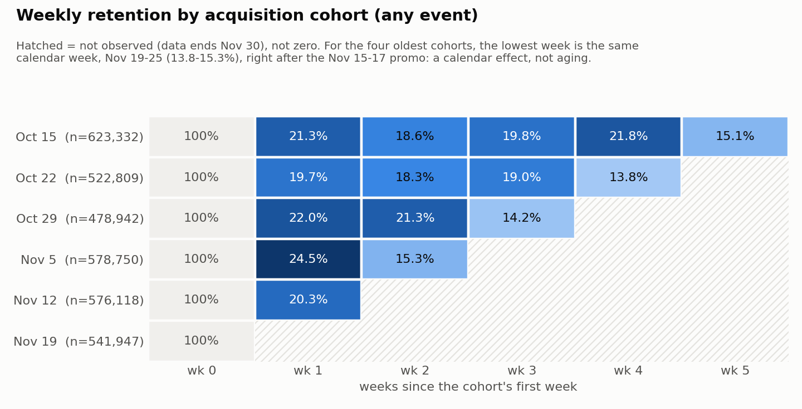
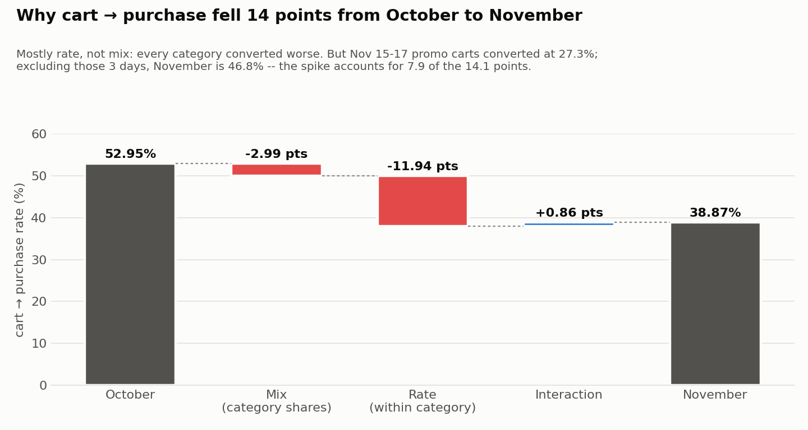

# Event-Level Funnel, Retention & Cohort Analysis

**The store's biggest problem isn't getting people back. It's getting them to
buy.** About 1 in 5 new users returns in any given week, but only about 1 in 10
of those returners buys. November's 14-point drop in cart → purchase
conversion was not a broken checkout. Most of it was the Nov 15–17 promotion
pulling in shoppers who carted heavily and bought at about half the normal
rate.

Built in Snowflake on two months (Oct–Nov 2019) of raw clickstream from a
multi-category ecommerce store: about 110M events, 5.3M users. One-page
summary for a non-technical reader: [MEMO.md](MEMO.md).

| | |
|---|---|
| Users who ever purchase | **13.12%** of 5,316,649 |
| Sessions that purchase (30-min sessions) | **6.86%** of 18,747,465 |
| Weekly return rate of new users, weeks 1–5 | **13.8–24.5%** |
| Returners who buy in a given week | **about 1 in 10** |
| Cart → purchase, Oct → Nov | **52.95% → 38.87%** (−14.08 pts) |
| …of which category mix | **−2.99 pts** (the rest is rate within category) |
| Nov 15–17 promo carts converting | **27.33%** vs 46.80% for the rest of November |
| Largest absolute loss, view → purchase | **electronics.smartphone**, 5.74M sessions |

---

## Findings

### 1. Funnel: two definitions, two jobs
Reach-based funnel: does a session or user have at least one view, cart, and
purchase, regardless of order.

- **User-level:** 13.12% of users ever purchase. It doesn't depend on any
  sessionization choice, so **use it for headline or external comparisons.**
- **Session-level:** 6.86% of 30-minute sessions purchase. It moves from 6.44%
  to 7.02% across 10/30/60-minute thresholds with no change in behavior, so it
  is only meaningful with the threshold attached. **Use it for internal
  week-over-week tracking**, where the threshold stays fixed.
- **Electronics.smartphone loses the most sessions in absolute terms** (5.74M
  viewed, never bought). That's the target for conversion work, rather than a
  small category with a worse rate on a few hundred sessions.

Caveat: 34% of purchases have no cart in the same session. The funnel is reach,
not a strict sequence. → [Phase 3 findings](reports/phase3_findings.md)

### 2. Retention: people come back to browse, not to buy



- Six weekly cohorts by first-seen week. Retention after week 0 runs
  13.8–24.5% for any event, but only **1–3% for purchases**.
- **Read it diagonally.** For the four oldest cohorts, the lowest week is
  the same calendar week, Nov 19–25, right after the promo. The dip is a
  calendar effect, not cohort aging.
- Cells after Nov 30 are **masked, not zero**. Without the mask, newer cohorts
  would appear to collapse right after joining.

→ [Phase 4 findings](reports/phase4_findings.md)

### 3. Repeat purchase: newer cohorts are not less loyal
Raw repeat-purchase rate falls from 33.4% to 19.5% across cohorts, which looks
like declining loyalty. It isn't: the oldest cohort had 47 days to buy again
and the newest had 12. **Over an equal 12-day window, every cohort repeats at
17.3–19.5%** with no trend.

### 4. Why conversion fell: mix shift vs rate change



Overall cart → purchase is each category's share of carts times its rate.
Changing one input at a time splits the −14.08-point drop:

| | points |
|---|---|
| Mix (carts shifting toward weaker categories) | −2.99 |
| **Rate (converting worse within category)** | **−11.94** |
| Interaction | +0.86 |

**All 14 categories converted worse.** Rate is 79–85% of the drop under every
baseline convention. But "rate change" here does **not** mean the checkout got
worse. Promo shoppers on Nov 15–17 carted in every category and bought at
27%, which lowers every category's rate. That's a shift in *who* was shopping,
along a dimension a category split can't see. **Excluding those 3 days
recovers 7.93 of the 14.08 points.** The remaining ~6 points are the part
worth investigating. → [Phase 5 findings](reports/phase5_findings.md)

---

## Metric layer

| Term | Definition | Why |
|---|---|---|
| Session | New session after **>30 min** of inactivity, per user (`sql/20_sessionize.sql`) | The shipped `user_session` column behaves like a page/tab ID: ours merge 15.55% of its sessions |
| Cohort | Week of a user's **first event**, weeks anchored to 2019-10-15 | Oct 1–14 is a **lookback**: users seen then are pre-existing, not new |
| Retained (primary) | Any event in week *k* after the cohort week | Engagement signal; purchase is too sparse weekly to read trends |
| Retained (secondary) | A purchase in week *k* | Reported alongside; the gap is the finding |
| Observable cell | Whole week ends on or before 2019-12-01 | Unobserved weeks are not computed, never shown as 0 |
| Repeat purchaser | Purchases in **more than one distinct session** | Rows overcount multi-item checkouts (37.75% vs 27.37%) |
| Cart → purchase | Of (session, top-level category) pairs with a cart, share that purchased in that category | A session's purchase isn't credited to a category it only browsed |

Every decision, alternatives considered, and what would change it:
[DECISIONS.md](DECISIONS.md).

---

## Limitations

- **No user attributes, acquisition channel, or marketing spend.** Attribution,
  LTV, and "which campaign drove the spike" are out of reach.
- **Two months is short.** Retention past 5 weeks is unobservable, and the
  equal-window repeat comparison can only cover 12 days.
- **Observational data.** Every finding is correlational. The promo
  explanation is the best fit to the daily data, not a tested cause.
- **No guardrail metrics** (returns, cancellations, support contacts). A
  "purchase" may later be refunded.
- **Cohorts are contaminated at the start.** There's no history before Oct 1,
  so some "new" users in the first three cohorts are returning customers who
  happened to be quiet for two weeks. Their week-0 purchase rates fall
  7.33% → 5.73% across the October cohorts, consistent with that.
- **October's funnel is inverted** (more purchasers than carters) for the same
  reason: 41.6% of October purchasers never carted, likely habitual buyers
  whose earlier browsing predates the data.
- **The 30-minute session threshold is a convention**, not ground truth, and
  session-level rates move with it.
- **The ~6 points of conversion decline left after removing the spike are
  unexplained.** This data can't say whether it's pricing, stock, or site
  changes.
- The load gate checks row counts against a local census, but **can't detect a
  partially truncated download**. No published checksum exists to compare
  against.

**Scale, stated plainly:** about 110M rows, 9 GB of CSV. That's comfortably
inside an X-Small warehouse, not "big data."

---

## Run it from a clean clone

Requires Python 3.12, a Snowflake account (key-pair auth), and a Kaggle API token.

```bash
python3.12 -m venv .venv && .venv/bin/pip install -r requirements.txt
cp .env.example .env                       # fill in Snowflake + Kaggle values

.venv/bin/python src/download.py           # ~9 GB from Kaggle into data/
.venv/bin/python src/load.py --setup       # warehouse, database, stage, table
.venv/bin/python src/load.py               # PUT + COPY INTO, reconciled to a local row census
.venv/bin/python src/verify.py             # Phase 0 gate, exits non-zero on failure
.venv/bin/python src/profile.py            # Phase 1 profile -> reports/phase1_profile.md
.venv/bin/python src/sessionize.py         # Phase 2: build + validate EVENTS_SESSIONIZED
.venv/bin/python src/run_all.py            # Phases 3-5: 37 assertions, results -> reports/data/
.venv/bin/python src/plots.py              # charts -> reports/figures/
```

`run_all.py` separates two kinds of checks. **Structural** checks are
identities that must hold whatever the data says: 21 observable retention
cells, week 0 = 100%, the decomposition summing exactly to the headline
change, and by-month user totals overcounting by exactly the users active in
both months. **Published** checks are the numbers quoted in this README, so
the write-up can't silently drift from the code.

## Repo layout

```
sql/        00-01 load · 10-11 profile · 20 sessionize · 30 funnel · 40-41 cohorts & retention · 50 mix shift
src/        config, download, load, verify, profile, sessionize, run_all, mix_shift, plots
reports/    phase1-5 findings (written), data/ (query results), figures/
DECISIONS.md  every analytical choice, the alternatives, and why
MEMO.md       one-page summary for a non-technical reader
```

The sessionization window function, funnel queries, retention matrix, and
mix-shift decomposition were written by hand. Loading, verification
harnesses, and plotting were AI-assisted (Claude Code).
